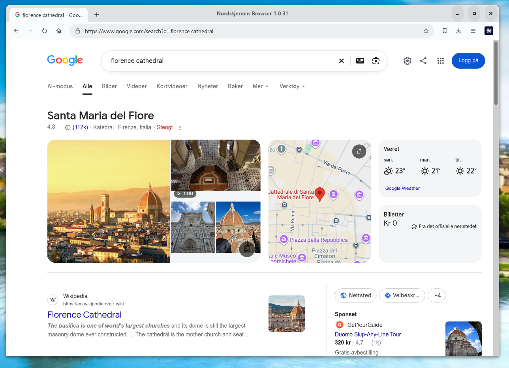

Nordstjernen web browser
========================

Nordstjernen (aka "Sol browser", shipped as **Nordstjernen Sol**) is a web
browser written from scratch in C, focused on support for modern HTML, CSS
and JavaScript standards.



Supported platforms:
* [Windows](https://apps.microsoft.com/detail/9nw8t7w5z4pl)
* MacOS
* Linux (glibc and musl/Alpine)
* FreeBSD and NetBSD
* [Android](https://play.google.com/store/apps/details?id=org.nordstjernen.WebBrowser)
* Java
* iOS (experimental port, simulator builds — see [docs/iOS.md](docs/iOS.md))

**Current release:** **1.0.35** (October 2026) — see [Changelog.md](Changelog.md).

**Standards.** Behaviour is measured against the spec text, section by
section, not against another browser. The walk-through of the in-scope
WHATWG HTML standard (§1–§16) in
[docs/HTML-compatibility.md](docs/HTML-compatibility.md) records **141 spec
rows fully implemented, 31 partial, 0 absent** (July 2026), besides a handful
that are non-goals by design: `embed`/`object` plugins, `frame`/`frameset`,
`applet`/`marquee`, telemetry, and AI-style web APIs.

Conformance is also measured with the shared test suites, run locally
against a static [web-platform-tests](https://github.com/web-platform-tests/wpt)
checkout (October 2026). These are the subtests that pass:

| Suite | Passing |
|-------|---------|
| WPT `css/` (6,991 test files) | 110,540 of 151,048 subtests (73.2 %) |
| WPT `html/`, `dom/`, `url/` and related (4,899 test files) | 151,974 of 166,164 subtests (91.5 %) |
| [test262](https://github.com/tc39/test262) on the QuickJS engine | 82,243 of 82,248 tests run (5 failures) |

The HTML run leaves out the `canvas`, `browsers` and cross-origin
directories. Tests that need the WPT Python server, such as
form-submission echo handlers, cannot pass against a static checkout
and are counted as failures. The test262 count covers the tests run
after the engine's feature exclusions.

**Security.** Each tab's engine runs in its own renderer process behind an
IPC + shared-memory boundary. On Linux the renderer is sandboxed with
seccomp + Landlock (the UI shell with Landlock); on macOS a Seatbelt profile
confines its file writes to the profile, cache, download and temporary
directories; on Windows it runs with process mitigation policies (forced
ASLR, strict handle checks, restricted image loads, no child processes) and
the browser drops administrator rights at start-up. The FreeBSD and NetBSD
builds have no renderer sandbox yet. No JIT, in either the JavaScript or the
WebAssembly engine.

**Minimalism.** The core engine is about 254,000 lines of project C and
headers, excluding vendored libraries and generated assets — small enough for
one person to read and audit end-to-end. See
[docs/Software-Architecture.md](docs/Software-Architecture.md) for a map of
the whole system.

See [Northstar](https://github.com/nordstjernen-web/northstar-browser)
for the GPL-licensed sibling project.


## Download

| Platform | Download |
|----------|----------|
| Windows | [Windows store](https://apps.microsoft.com/detail/9nw8t7w5z4pl) |
| Android | [Google Play](https://play.google.com/store/apps/details?id=org.nordstjernen.WebBrowser) |
| macOS | notarised Apple Silicon `.dmg` on [GitHub Releases](https://github.com/nordstjernen-web/nordstjernen-sol-browser/releases) |
| Debian / Ubuntu | `.deb` packages (Debian 13, Ubuntu 24.04 and 26.04) and a portable Linux `.zip` on [GitHub Releases](https://github.com/nordstjernen-web/nordstjernen-sol-browser/releases) |
| Java/JVM | [`org.nordstjernen:nordstjernen-java`](https://github.com/nordstjernen-web/nordstjernen-sol-browser/packages) on GitHub Packages (Maven) |
| Source | [release tags](https://github.com/nordstjernen-web/nordstjernen-sol-browser/tags) |

Windows 10 version 1809 or later on x64 is required. Android 14 or later
is required (arm64 and x86_64). Other platforms build from source — see
"Build" below and the per-platform install notes in [docs/](docs/README.md);
packaging scripts for AppImage, RPM, Alpine, the BSDs, MSIX and the Windows
installer are in `scripts/`.

## Browser features

- **HTML/CSS** — HTML is parsed by the in-tree lexbor engine; XHTML, SVG and
  other XML documents go through an in-tree namespaced XML parser, and JSON
  and XML responses are shown pretty-printed. The CSS engine covers the
  modern cascade and CSSOM (`@layer`, `@scope`, nesting, `:has()`,
  `@property`), Media Queries Level 4, size container queries and units,
  flex, grid (with partial subgrid), multi-column, sticky positioning,
  scroll snap, 2D and 3D transforms, filters, masks and blend modes,
  gradients, transitions, animations, scroll-driven animations and
  `text-wrap: balance`. It also covers CSS Color 4/5 (`oklch()`,
  `color-mix()`, relative colors, `light-dark()`, `contrast-color()`) and
  CSS anchor positioning with `@position-try` fallbacks. Vertical writing
  modes lay out vertical text runs, but block flow is not yet turned
  sideways. `clip-path` paints `circle()`, `ellipse()`, `polygon()` and
  `inset()`; `path()`, `shape()` and `shape-outside` are parsed, and floats
  do not yet wrap around a shape. Web Animations composition
  (`add`/`accumulate`) works for transforms, filters, shapes, lengths and
  colors, and 2D transform lists interpolate through matrix decomposition.
  See [docs/CSS-compatibility.md](docs/CSS-compatibility.md).
- **Text layout** — desktop builds shape text with **web-text-lib**, a Pango
  fork vendored in-tree at `src/web-text-lib/` that caches shaped glyph
  strings, itemization, line breaks and font metrics across layouts, so
  measuring and painting a run reach HarfBuzz once instead of three times.
  Android and iOS link the system Pango; `-Dweb-text-lib=disabled` builds
  that path on the desktop too.
- **JavaScript** on the QuickJS interpreter — DOM, Shadow DOM, observer APIs,
  Canvas 2D (`Path2D`, `ImageBitmap`, `DOMMatrix`, `OffscreenCanvas`),
  WebCrypto (`crypto.subtle` over OpenSSL), custom elements including
  customized built-ins (`is=` / `{extends}`), and the `Navigation` API for
  single-page routing, plus dedicated and module Web Workers, Service Workers
  (which intercept the page's own `fetch()`), Streams, IndexedDB (over
  SQLite), WebSocket, `EventSource`, Web Animations (`Element.animate`),
  Fullscreen and Pointer Lock. The quickjs-ng fork carries `Temporal`, the
  full `Intl` suite without ICU, and `ShadowRealm`. Much of the higher-level
  Web API surface is a JavaScript prelude (`data/js/polyfills.js`) compiled
  into the binary. Each renderer keeps compiled script bytecode in memory, so
  a script loaded again skips recompilation. The QuickJS engine is selectable at build time: the in-tree
  quickjs-ng fork by default, or Fabrice Bellard's original QuickJS with
  `-Dquickjs=quickjs` — see [docs/quickjs.md](docs/quickjs.md).
- **Networking** over HTTP/2 with libcurl — HSTS, HTTPS-First (on by
  default), a Content Security Policy Level 2 subset, subresource integrity
  for scripts, CORS, mixed-content blocking, Fetch Metadata headers, cookies
  partitioned by top-level site with third-party cookies blocked by default,
  speculative subresource loading, request coalescing and a `Vary`-aware
  HTTP cache. HTTP, HTTPS and SOCKS proxies ([docs/Proxy.md](docs/Proxy.md))
  and DNS-over-HTTPS are configurable. An in-tree **libnghttp2** transport
  backend is selectable at build time (`-Dhttp_backend=nghttp2`), with
  **HTTP/3 over QUIC** via ngtcp2 + nghttp3 + gnutls when present. Both
  backends fetch through the same browser policy (redirects, HSTS, referer,
  cache, cookies), so the independent transports cross-check each other. See
  [docs/http-backends.md](docs/http-backends.md).
- **Images and graphics** — Wuffs decodes PNG/APNG, GIF, BMP, JPEG and simple
  lossy and lossless WebP; libwebp handles extended WebP (alpha and
  animation); ICO and SVG are rendered in-engine, with optional AVIF (still
  images), JPEG XL and inline PDF support (poppler renders each page as an
  image). Animated images play as many times as their loop count asks. Web
  fonts load as TTF/OTF, WOFF and WOFF2 (in-tree decoder over brotli).
- **Media** — `<video>` plays **inline** for MPEG-1 (decoded in-tree by
  [pl_mpeg](https://github.com/phoboslab/pl_mpeg)), **WebM** and Ogg
  (VP9/VP8/Theora + Opus/Vorbis) through FFmpeg's libav, which Linux and
  Windows builds require, and **MP4 with H.264/AAC**, decoded by the
  operating system — Media Foundation on Windows, VideoToolbox on macOS/iOS,
  MediaCodec on Android and GStreamer on Linux/BSD — or by the system FFmpeg
  where no OS decoder is available, never by a bundled decoder. A
  distribution FFmpeg on Linux adds AV1 and HEVC. MSE/`blob:` streaming
  decodes in the renderer, HLS and DASH manifests play through a built-in
  player over MSE, and a `<track default>` WebVTT file is drawn over the
  video. `<audio>` plays MP3 (via minimp3) and, with libav, WebM, Ogg and
  Opus files. All audio, including the MP2 and AAC tracks of video, plays
  through a separate `nordstjernen-audio` helper over SDL2. Other codecs
  render a poster and play overlay. See [docs/media.md](docs/media.md).
- **Web Audio and capture** — `AudioContext`/`OfflineAudioContext` graphs are
  mixed in-engine by a simplified mono renderer (no `AudioWorklet`);
  `getUserMedia` reaches the microphone (SDL capture, read through an
  `AnalyserNode`) and, on Linux, a V4L2 webcam, behind a per-site permission
  prompt.
- **WebGL / WebGPU / WebAssembly** — WebGL 1/2 on desktop builds, on by
  default: over OpenGL ES on Linux and the BSDs, desktop OpenGL on Windows,
  and WebGL 1 over OpenGL 4.1 on macOS ([docs/webgl.md](docs/webgl.md));
  experimental `navigator.gpu` over wgpu-native (fetched and linked
  statically on Linux, macOS and Windows when not installed), on by default
  and switchable in Settings ([docs/webgpu.md](docs/webgpu.md)); the core
  WebAssembly JS API (MVP, reference types and bulk memory) over a vendored
  WAMR interpreter ([docs/webassembly.md](docs/webassembly.md)).
- **MathML** — a minimalist presentation-MathML renderer (`src/mathml.c`)
  for fractions, roots, scripts, under/over and tables, laid out over
  Pango/Cairo and embedded inline on the text baseline.
- **Spell checking** — optional, via Enchant: misspelled words in editable
  text get a red wavy underline, honouring the `spellcheck` attribute.
- **Safe browsing** — a top-level navigation's host, including a form
  submission's and each redirect's, is checked against a local SHA-256
  blocklist before it is fetched, entirely on-device; a match shows a
  full-page warning. The bundled list is only a seed: add hosts in
  `~/.config/nordstjernen/safebrowsing.list`, or point
  `NS_SAFEBROWSING_LIST` at a list that replaces it.
- **Remote control for agents** — `nordstjernen --mcp` is a built-in MCP
  server that lets a local agent such as Claude Code read and drive the
  browser window (tabs, page outline with element refs, clicks, typing,
  screenshots, JavaScript), starting a browser if none is running. Off
  until allowed in Settings or with `--remote-control`; loopback only,
  token-authenticated, with a toolbar badge while connected
  ([docs/remote-control.md](docs/remote-control.md)).
- **Process-per-tab** — each tab's engine runs in its own sandboxed
  `nordstjernen-renderer` process; the GTK app is a thin shell that composites
  the shared-memory tiles the renderer paints and forwards input over an
  HTTP/JSON control channel, so a page can't take down the UI
  ([docs/tab-isolation.md](docs/tab-isolation.md)). `--single-process` runs
  the engine in the shell process instead, one tab per window
  ([docs/single-process-mode.md](docs/single-process-mode.md)). A watchdog
  supervisor restarts the browser after a crash or hang and reopens the tabs
  that were open ([docs/watchdog.md](docs/watchdog.md)).
- **Privacy** — no telemetry or update pings. HTTPS-First, stripping of
  tracking parameters (`utm_*`, `gclid`, `fbclid`, …) and blocking of
  third-party cookies are on by default; Do Not Track and Global Privacy
  Control are opt-in. Client hints are standards-compliant, safe browsing is
  local-only, and private tabs (`Ctrl+Alt+P`) and `--private` windows leave
  no cookies, HTTP cache or IndexedDB data behind
  ([docs/privacy-policy.md](docs/privacy-policy.md)).
- **UI** — tabs, bookmarks, history, downloads, find-in-page, page zoom, full
  screen, light/dark/system themes, `view-source:`, printing and saving as
  PDF or PNG, Developer Tools (Console, Network, Performance, Layout and
  Elements), a Task Manager (`Shift+Esc`) with per-process CPU and memory,
  recovery of open tabs after a crash, settings, and a C embedding API
  ([docs/Embedding.md](docs/Embedding.md)). A headless mode (`--headless`
  with `--dump=text|dom|layout|png:FILE|pdf:FILE`, `--eval=` and
  `--viewport=`) drives the engine from scripts; `nordstjernen --help` lists
  the main options. The browser's name is translated into 40 languages and
  the core interface into 13; the UI follows the operating-system language
  ([docs/i18n.md](docs/i18n.md)).
- **Extensions** — initial support for simple, page-facing WebExtensions:
  content scripts, a slice of `browser.*`, and content blocking through
  static `declarativeNetRequest` rules and Adblock Plus/EasyList filter
  lists ([docs/extensions.md](docs/extensions.md)).
- **Java/JVM** — `org.nordstjernen.Nordstjernen` drives fetch / parse / layout
  / script / render from Java over a JNI bridge, or `RemoteBrowser` /
  `RemotePage` drive a separate renderer process so an engine crash can't take
  down the JVM. The nightly fat jar is both the embedding library and a Swing
  browser (`java -jar nordstjernen-java.jar <url>`) that drives a
  `nordstjernen-renderer` installed on the host; JDK 21 is required. See
  [java/README.md](java/README.md).

## Build

On Debian and Ubuntu, `apt build-dep .` installs everything
`debian/control` lists, so no optional feature (AVIF, JPEG XL, H.264
video, spell checking, PDF) is silently left out:

```sh
sudo apt install git
git clone https://github.com/nordstjernen-web/nordstjernen-sol-browser.git
cd nordstjernen-sol-browser
sudo apt build-dep .
meson setup builddir && meson compile -C builddir
./builddir/src/gtk/nordstjernen
```

Windows, Fedora, openSUSE and macOS instructions are in
[docs/](docs/README.md); keyboard, mouse and touch controls are in
[docs/Controls.md](docs/Controls.md).

### The `internet-browser` command

`meson install` puts `internet-browser` beside `nordstjernen` in the binary
directory, a symbolic link to it, so `internet-browser https://example.com`
starts Nordstjernen. Northstar and Southstar install the same name, so the
command opens whichever of the browsers is installed. The `.deb` and `.rpm`
packages register it with `update-alternatives` instead of shipping the
link, so the browsers install side by side and
`sudo update-alternatives --config internet-browser` chooses the one it
runs. The Alpine package creates the link when no other browser holds
the name. On Windows the installer registers `internet-browser` as an App
Paths alias (the Run dialog and `start internet-browser` find it) and the
MSIX package declares it as an app execution alias.

## Dependencies

Nordstjernen is an independent engine — no upstream browser code.

**Vendored in-tree**, built from the main tree with no submodules:
[lexbor](https://github.com/lexbor/lexbor) (HTML5 → DOM parser, CSS, and the
WHATWG URL module), [QuickJS](https://github.com/quickjs-ng/quickjs)
(quickjs-ng fork, no JIT), [WAMR](https://github.com/bytecodealliance/wasm-micro-runtime)
(WebAssembly interpreter), [Wuffs](https://github.com/google/wuffs)
(memory-safe image decoding), [pl_mpeg](https://github.com/phoboslab/pl_mpeg)
(MPEG-1 video + MP2 audio), [minimp3](https://github.com/lieff/minimp3)
(MP3) and web-text-lib (`src/web-text-lib/`, the text-shaping Pango fork
that began as [ns-pango](https://github.com/nordstjernen-web/ns-pango)). The
first `meson setup` downloads one pinned subproject, the
[wgpu-native](https://github.com/gfx-rs/wgpu-native) release for WebGPU,
linked statically; `-Dwebgpu=disabled` drops WebGPU and needs no network.

**Required system libraries:**

| Library | Min version | Role |
|---------|-------------|------|
| GTK 4 | **≥ 4.22.1 on Windows** (MSYS2 stock), ≥ 4.14 elsewhere (≥ 4.22 preferred) | UI toolkit, GSK renderer |
| GLib / GModule, Pango, cairo, HarfBuzz, FriBidi, fontconfig | (ship with GTK; web-text-lib needs GLib ≥ 2.80, cairo ≥ 1.18, HarfBuzz ≥ 8.3, FriBidi ≥ 1.0.6, fontconfig ≥ 2.15) | core types, dynamic module loading, text shaping, 2D drawing |
| libepoxy | — (with EGL on Linux) | OpenGL/ES function dispatch for WebGL |
| libcurl | ≥ 8.5 (≥ 8.11 for WebSocket) | HTTP/2 networking, HSTS, cookies, native WebSocket |
| OpenSSL (libcrypto, libssl) | — | WebCrypto (`crypto.subtle`), TLS for the nghttp2 backend |
| uchardet | — | charset detection |
| libpsl | — | public-suffix list for cookie scoping |
| SQLite | — | IndexedDB persistent storage |
| libwebp, libwebpdemux | — | extended (alpha and animated) WebP decoding |
| zlib | — | `CompressionStream` / `DecompressionStream`, and gzip/deflate in the nghttp2 backend |
| FFmpeg libav\* | ≥ 6.0 (Linux, Windows; optional on macOS and the BSDs) | inline WebM/Ogg (VP9/VP8/Theora video, Opus/Vorbis audio) |
| libseccomp | — (Linux only) | renderer syscall sandbox |

**Optional**, auto-detected or build-time-selected:
SDL2 (audio output and microphone capture, `-Daudio`),
[FFmpeg](https://github.com/FFmpeg/FFmpeg) libav\* on macOS and the BSDs (inline WebM),
GStreamer ≥ 1.20 (H.264/AAC on Linux and the BSDs, `-Dgstreamer`),
vorbisfile / opusfile (Ogg audio without FFmpeg), brotli (WOFF2 fonts and
HTTP content encoding), zstd (HTTP content encoding in the nghttp2 backend),
poppler-glib (inline PDF), libavif (AVIF images), libjxl (JPEG XL images),
Enchant (spell checking), FreeType (extra font backend), [libnghttp2](https://github.com/nghttp2/nghttp2) (the
in-tree HTTP/2 backend), [ngtcp2](https://github.com/ngtcp2/ngtcp2) +
[nghttp3](https://github.com/ngtcp2/nghttp3) + GnuTLS (HTTP/3 over QUIC inside
it), wgpu-native on platforms it publishes no release for (the BSDs, musl,
Windows on Arm; WebGPU is not built for Android and iOS) and Fabrice
Bellard's original
[QuickJS](https://github.com/bellard/quickjs) (`-Dquickjs=quickjs`, fetched
through a meson wrap).

## License

Nordstjernen is dual-licensed: use it under **either** the Nordstjernen
Source License v1.0 **or** the GNU General Public License version 3 or later,
at your option (`LicenseRef-NSL-1.0 OR GPL-3.0-or-later`).

- **GPL-3.0-or-later** — free software: use, modify and redistribute it for any
  purpose, provided derivative works are also released under the GPL. See
  [COPYING](COPYING).
- **NSL-1.0** — use, modify and redistribute freely, except as a competing
  browser; each release becomes MIT after ten years. It is inspired by the
  [Functional Source License](https://fsl.software/).

See [License.md](License.md) for the full terms. Commercial licenses by
agreement. Bundled third-party components keep their own licenses
([THIRD-PARTY-LICENSES.md](THIRD-PARTY-LICENSES.md)).

# Development team
Nordstjernen is developed by a team located in Norway, Poland and Spain.  

Project home: <https://nordstjernen.org>  

[Join the Discord](https://discord.gg/4W959nW5vF)  

## Builds
[](https://github.com/nordstjernen-web/nordstjernen-sol-browser/actions/workflows/linux.yml)
[](https://github.com/nordstjernen-web/nordstjernen-sol-browser/actions/workflows/macos.yml)
[](https://github.com/nordstjernen-web/nordstjernen-sol-browser/actions/workflows/windows.yml)
[](https://github.com/nordstjernen-web/nordstjernen-sol-browser/actions/workflows/android.yml)
[](https://github.com/nordstjernen-web/nordstjernen-sol-browser/actions/workflows/java.yml)
[](https://github.com/nordstjernen-web/nordstjernen-sol-browser/actions/workflows/freebsd.yml)
[](https://github.com/nordstjernen-web/nordstjernen-sol-browser/actions/workflows/netbsd.yml)
[](https://github.com/nordstjernen-web/nordstjernen-sol-browser/actions/workflows/musl.yml)


----

Copyright 2026 Andreas Røsdal ·  
